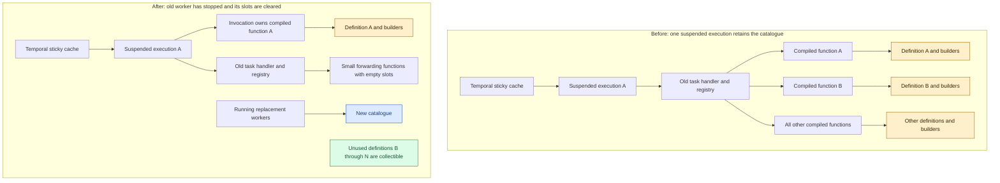

# Workflow reload memory retention

Zigflow starts replacement workers before stopping the previous generation. After
an old worker finishes stopping, Zigflow detaches the compiled workflow functions
from that worker's registrations. Suspended cached invocations retain their own
workflow definition and helpers. They no longer retain every unrelated definition
from the same catalogue.

The Temporal SDK and its normal sticky cache remain unchanged. There is no global
cache purge, cache disablement, or interval in which the reload deliberately
stops every worker before starting replacements.

## Ownership before and after retirement



A registration slot contains one atomic pointer to a compiled function. The SDK
receives a forwarding function created through its public registration API.
`reflect.MakeFunc` preserves the original function type, including the private
result type used by `for` children. No SDK registry fields are modified or
accessed through reflection. All CLI DSL workflows have explicit names; callers
must invoke those names rather than Go function aliases.

On entry, the forwarding function loads its target into a local reference. The
invocation keeps that reference until it returns, including while suspended.
After SDK `Stop` returns, clearing the slot removes the registry's ownership of
the compiled function. A task builder can still reference its old worker, but
that worker now leads only to empty forwarding slots. Already-entered invocations
can finish safely. Completion or cache eviction eventually releases their own
old definitions as well.

Small SDK registry maps, names, forwarding functions and shared activity handlers
can remain cached. This removes heavy catalogue amplification, not every byte
associated with an old worker. A genuinely needed old definition remains alive.

## Reload, rollback and shutdown

```mermaid
sequenceDiagram
  participant Watch as Reload controller
  participant Old as Current workers
  participant New as Replacement workers
  participant Slots as Old registration slots
  Note over Old: Still polling and processing tasks
  Watch->>New: Build and validate the complete catalogue
  Watch->>New: Start every replacement task queue
  alt Build or any Start fails
    Watch->>New: Stop attempted workers and discard all replacement slots
    Note over Old: Same workers keep running; no restart or rebuild
  else All replacements start
    Note over New: Replacements already polling
    Watch->>Old: Stop with the configured grace period
    Old-->>Watch: SDK Stop returns
    Watch->>Slots: Clear compiled function targets
    Note over Slots: Existing invocations still own their functions
    Note over New: Continue running with normal caching
  end
```

Worker startup, registration and shutdown are serialised. Concurrent `Stop`
calls stop the SDK worker once. Shutdown waits for an in-progress `Start` before
stopping its pollers, including when `Start` returns an error. Workers discarded
before any start attempt release their registrations without calling SDK `Stop`.
No lifecycle lock is held while executing a workflow.

The watch loop handles a reload and shutdown sequentially. If cancellation arrives
during replacement startup, it finishes that handoff or rollback, then stops the
current generation. It creates one interrupt channel for the watch loop rather
than another signal listener for every file event.

A function entering an already-cleared slot panics instead of returning a result
or an ordinary workflow error. CLI workers use Temporal's default `BlockWorkflow`
panic policy, so this is a failed workflow task to retry, not a failed durable
execution. The slot is cleared only after SDK shutdown, so normal handoffs should
not take this path. The lifecycle tests cover both late entry and invocations
already running when shutdown finishes.

Rollback here means preserving the old workers. It cannot undo activity effects
or histories written by a replacement that polled before another queue failed to
start. Both catalogues must be compatible during their overlap, as with an
ordinary rolling deployment.

## Evidence behind the change

The investigation used deployed commit `a3d40cb876bbdbd36859d9e8a5a579e12946a6b8`,
Go 1.26.4 and Temporal Go SDK 1.46.0, including the activity-registration cleanup
from [PR #1](https://github.com/talismanai/zigflow/pull/1).

### Production profiles

Forced-GC profiles of two US secondary workers at **2026-11-24 22:03:40–46 UTC**,
outside their observed reload windows, showed:

| Pod suffix | RSS after GC | Runtime allocated heap after GC | Sampled live heap | Live bytes attributed to reload allocation stacks |
| --- | ---: | ---: | ---: | ---: |
| `mjw7p` | 13.11 GiB | 8.06 GiB | 8.05 GiB | 95.15% |
| `vltth` | 13.32 GiB | 8.42 GiB | 8.48 GiB | 95.35% |

The retained allocation stacks pass through `handleDebounce`, definition loading
and `DoTaskBuilder.Build`. Cumulative profile rows overlap and must not be summed.
Heap profiles identify allocation sites, not the complete ownership graph. Source
inspection and the controlled regression establish the reference chain shown
above. These observations do not prove that every byte of RSS has this cause.

In SDK 1.46.0, the shared sticky cache retains execution contexts, task handlers
and their registries. The original registry stores compiled closures directly.
The earlier fix released Zigflow's separate activity-registration map; its
registration-only experiment did not start suspended workflows and therefore did
not exercise this sticky-cache path. That activity cleanup remains necessary.

Relevant SDK source:

- [Shared workflow cache](https://github.com/temporalio/sdk-go/blob/v1.46.0/internal/internal_worker_cache.go)
- [Execution context, task handler identity and replay](https://github.com/temporalio/sdk-go/blob/v1.46.0/internal/internal_task_handlers.go)
- [Registry and worker shutdown](https://github.com/temporalio/sdk-go/blob/v1.46.0/internal/internal_worker.go)

### Regression and negative control

`TestReloadSuspendedWorkflows` uses real YAML loading, DSL builders,
`handleDebounce` and a local Temporal server with the normal cache enabled. Four
worker generations each register a signal-suspended workflow, a loop with two
signal-suspended children, and an unused HTTP workflow containing an 8 MiB
synthetic metadata payload. Only that unused payload changes between reloads.
The HTTP workflow is never executed, but exercises activity-registration cleanup.

After three reloads, before resumption:

| Retired definitions | Expected live objects |
| --- | ---: |
| Direct workflows still suspended | 3 |
| Loop workflows with suspended children | 3 |
| Unused workflows from the same catalogues | 0 |

All eight roots and eight children must then complete with exact outputs and no
failed workflow tasks. Root execution run IDs are preserved. The second child in
each loop starts after the reloads, exercising continued dispatch. All nine
retired definitions must become collectible while replacements remain running.
Assertions use weak references and GC, not a platform-dependent RSS threshold.

Additional regressions cover:

- Build failure after registration, first-start failure, partial multi-queue
  startup, and disposal of never-started replacements.
- Real SDK startup failures before and after polling, collection of the failed
  catalogue, and resumption on the same original worker after rollback.
- Repeated concurrent stops, startup racing shutdown, late registration and late
  function entry, and a suspended invocation finishing after its slot is cleared.
- Context cancellation during a real file-triggered reload, with both successful
  and failed replacement startup.
- Preservation of named registration options, typed child results, nil arguments,
  returned errors and workflow panics.

The ownership and lifecycle regressions passed three consecutive runs with the
race detector enabled. At the third reload, the three runs retained six needed
old definitions and zero unrelated old definitions, with post-GC allocated heaps
of 23.08, 24.53 and 24.13 MiB. These synthetic byte measurements are illustrative,
not estimates of production savings or CPU overhead.

To reproduce against an isolated local Temporal server:

```sh
TEMPORAL_ADDRESS=127.0.0.1:7233 go test -race -tags=e2e ./cmd/run \
  -run 'TestReload(Suspended|Rollback)|TestWatchShutdownDuringReload|TestCatalogueWorker|TestReplaceWorkersLifecycle' \
  -count=3 -v
```

Set `ZIGFLOW_PROFILE_DIR` to an existing directory to also save per-generation
heap profiles. For a negative control, copy `cmd/run/catalogue_worker.go` outside
the checkout and remove only the loop that calls `slot.target.Store(nil)` in
`Stop`. Use a Go overlay JSON with `Replace` mapping the absolute source path to
the copy, then repeat `TestReloadSuspendedWorkflows` with `go test -overlay=...`.
This control failed the unrelated-definition collection assertion at the first
reload, as expected. Do not deploy this control. The test never purges the cache,
including during cleanup.

## Production considerations

- Replacement workers keep polling while old workers stop. Their construction
  and startup temporarily overlap the old catalogue, so capacity must cover both.
  Stopping old workers still honours the configured grace period; interrupted
  activities remain subject to their existing retry and timeout policies.
- Keeping the cache avoids replay on every subsequent task. It does not eliminate
  normal replay at worker handoff: SDK 1.46.0 rejects cached contexts from
  another task handler and reconstructs them on the replacement. Long histories
  can still cause a temporary CPU and latency increase after reloads.
- This is memory ownership, not durable definition versioning. Changed definitions
  must replay open executions correctly after reload, eviction or process loss.
  Removing a workflow type can still strand its open executions. Production logs
  already contained `TMPRL1100` replay errors and `TMPRL1101` non-yield warnings;
  this fix does not establish their causes or repair those histories.
- Existing pods need a normal image rollout to use the wrapper. The patch cannot
  detach raw registrations created by the old binary in a still-running process.
- Many legitimately needed definitions or large execution states can still consume
  substantial memory. RSS may not fall when objects are collected because Go can
  retain pages for reuse. Compare post-GC live heap across several reloads,
  together with task failures, latency, backlog, CPU and activity retries.

The local regressions establish this retention fix and compatible resumption.
Use a limited production rollout and repeated profiles to measure actual savings
before expanding it. The PR itself does not deploy an image or alter cache limits.
